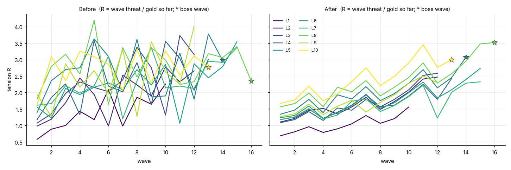
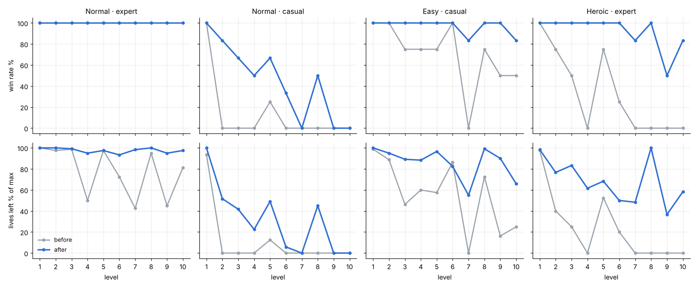

# 밸런스 곡선

웨이브의 세기와 경제를 하나의 곡선으로 맞추고, AI 플레이 시뮬레이션으로 확인합니다. 숫자를 손으로 고치기 전에 이 문서의 순서(아래 "도구와 순서")를 따릅니다.

## 참고한 자료

- **Kingdom Rush**(이 게임의 장르 기준):
  - 스테이지의 웨이브 수는 7개에서 19개로, 시작 골드는 265에서 1300으로 캠페인을 따라 늘어납니다. 생명은 20입니다.
  - 난이도는 적 체력만 바꿉니다(쉬움 x0.8, 베테랑 x1.2).
  - 타워 비용은 단계마다 약 1.5배입니다(궁수 70/110/160, 마법사 100/160/240). 판매는 60%(첫 웨이브 전에는 전액)입니다. 이 게임의 타워 비용도 같은 틀입니다.
  - 적 현상금은 체력의 0.75제곱에 비례합니다. 고블린 20HP는 3골드, 오크 80HP는 9골드, 다크 나이트 300HP는 25골드, 오우거 800HP는 50골드로, 모두 0.33 x HP^0.75 근처입니다. 튼튼한 적일수록 체력당 골드가 적어서, 뒤로 갈수록 업그레이드 효율로 버텨야 합니다.
- **웨이브 체력 성장 모델**(타워 디펜스 웨이브 계산기 정리): 선형, 지수 `기본 x (1+g)^(w-1)`, 거듭제곱, 혼합이 있습니다. 캠페인 초반은 선형이나 낮은 지수를 쓰고, 보스는 그 웨이브 체력에 배수를 곱합니다. 화력 비교는 방어·저항을 반영한 유효 체력으로 하고, 빠른 적은 사거리 안에 짧게 머무는 점을 따집니다.
- **난이도 곡선**: 직선 오르막이 아니라 톱니입니다. 올라가다 숨 고르기가 오고, 고비 다음에는 잠깐 쉬워져서 이겼다는 느낌이 남습니다. 새 메커니즘은 그때의 숙련도보다 낮은 곳에서 처음 보여 줍니다.
- **Goal Defense**(출시작의 설계 글): 1~2웨이브마다 새 타워를 살 수 있게 하고, 레벨 끝으로 갈수록 결정이 복잡해지며, 자원은 부지가 60~70% 찼을 때 바닥나게 합니다. 10~11웨이브면 극적인 레벨을 만들 수 있다고 봅니다.
- **Bloons TD 6**: 라운드의 총 체력(RBE)과 수입이 함께 오르고, 80라운드 뒤에야 체력 램프가 붙습니다. 캠페인 구간에서는 위협이 경제를 크게 앞지르지 않습니다.

## 이 게임의 곡선

### 위협과 긴장도
- **웨이브 위협** = Σ 마릿수 x 유효 체력 x 속도 배수 x 특수 능력 x 공중 배수
  - 유효 체력: 체력 x 레벨 체력 배수를 방어력·마법 저항으로 나눈 값(물리·마법 반반 기준). 되살아나는 해골 기사는 1.5배로 칩니다.
  - 속도 배수: (속도 / 2)^0.5. 빠를수록 사거리 안에 짧게 머뭅니다. 느린 대형 적도 병사를 묶어 두므로 지수를 1보다 작게 둡니다.
  - 특수 능력: 내려찍기(병사 기절) 1.3, 함성(주변 가속)·치유·자폭 1.2, 은신(궁수·포병이 못 봄)·방패 진형(주변 방어력 +30%) 1.3, 투창(멈춰 서서 병사 공격) 1.15.
  - 공중: 1.5. 궁수·마법사만 칠 수 있습니다.
  - 보스는 위협에서 뺍니다. 보스 체력은 시뮬레이션으로 따로 맞춥니다.
- **긴장도 R** = 웨이브 위협 / 그 웨이브 전까지 모은 골드(시작 골드 + 앞 웨이브 현상금). 방어에 쓴 1골드가 이번 웨이브에서 상대할 위협입니다.

### 목표 곡선
- 레벨 안(지수 추세 x 톱니): `R(w) = R0 x 2.0^(w/(N-1)) x 톱니(w)`, w = 0..N-1. 마지막 웨이브의 긴장도는 첫 웨이브의 2배입니다.
- 톱니: 4웨이브 주기로 평온 0.94, 오름 1.03, 고비 1.16, 숨 고르기 0.87을 반복합니다. 마지막 웨이브는 절정으로 1.12입니다.
- 캠페인(레벨 사이):
  - R0는 튜토리얼 0.7, 그다음부터 0.95 + 0.08 x 레벨로 천천히 오릅니다.
  - 보스 레벨 다음 레벨은 첫 웨이브를 x0.9로 낮춥니다. 캠페인 단위의 톱니입니다.
- 현상금: 일반 적은 0.3~0.46 x HP^0.75. 보스는 약 0.75로 보상을 크게 줍니다.
- 곡선의 **모양은 웨이브별 마릿수**로, 레벨의 **높이는 레벨 체력 배수(hp_mult)**로 맞춥니다.
  - R은 체력 배수에 정비례하고, 골드는 체력과 상관이 없습니다. 그래서 체력 배수로 높이를 바꿔도 모양과 수입은 그대로입니다.
  - 마릿수만으로 R을 낮추면 적이 줄면서 현상금도 같이 줄어 R이 잘 내려가지 않습니다. 결국 무리만 얇아집니다(처음 시도에서 적이 20~40% 줄었습니다).
  - 레벨의 총 마릿수는 처음 손으로 짠 웨이브와 같게 둡니다(`tuning.json`의 `enemy_total`). 무리의 크기와 수입이 유지됩니다.
- 적 구성(어떤 적이 언제 나오는지)은 손으로 짠 그대로 둡니다.
  - 무리 최소: 작은 적 3마리, 중간 적 2마리. 대형 적(족장·오우거)은 한 마리도 됩니다.
  - 마릿수를 바꾸면 출현 간격을 반대로 바꿔 웨이브 길이를 유지합니다.
  - 이미 최소 구성인 웨이브(첫 오우거와 호위 몇 마리)는 곡선 위에 있어도 됩니다. 새 적을 소개하는 자리입니다.

### 시뮬레이션 보정(`tools/balance/tuning.json`)
같은 R이라도 지형·갈래 수·조합 때문에 더 어렵거나 쉬운 곳이 있습니다. 이런 곳은 AI 플레이 결과로 맞춥니다.
- `level_scale`: 레벨 전체 배수입니다. 통곡의 폭포는 갈래가 둘이고 해골 기사가 많아 x0.82, 폭풍 항구는 오우거 웨이브가 몰려 x0.88, 달빛 숲은 오우거·족장이 겹치는 8웨이브 때문에 x0.92입니다.
- `wave_adj`: 조합 때문에 튀는 웨이브의 배수입니다. 예를 들어 폭풍 항구 7웨이브(두 번째 길로 오는 오우거)는 x0.66입니다.
- `enemy_total`: 레벨의 총 마릿수(위 참고).

## 검증(AI 플레이)

`tools/balance/sim.py`가 test_runner의 AI를 헤드리스로 돌립니다(`--fixed-fps 60`, 한 판에 몇 초).
- **expert**: 길을 가장 많이 덮는 부지에 짓고, 다가올 적에 맞춰 타워를 고르고, 업그레이드·특수 능력·주문·영웅 이동을 씁니다. 조기 호출도 합니다.
- **casual**: 첫 플레이어 흉내입니다. 반응이 느리고(2.5초), 타워 절반과 부지를 무작위로 고르고, 특수 능력을 사지 않고, 주문을 드물게 쓰고, 조기 호출을 하지 않습니다.
- 둘 다 그 레벨까지 왔을 플레이어의 상태로 시작합니다. 앞 레벨당 별 3개어치 업그레이드를 갖고, 앞 레벨 현상금만큼의 영웅 경험치(등급·재능)를 갖습니다.
- 같은 시드로도 판마다 조금씩 달라집니다(로딩·워밍업 프레임 수 등). 레벨마다 6판 이상의 평균으로 봅니다.

목표:

| 난이도 | 플레이어 | 목표 |
|---|---|---|
| 보통 | expert | 모든 레벨 승리, 평균 생명 16.5 이상. 잃는 생명은 고비와 마지막 웨이브에 몰림 |
| 보통 | casual | 앞 레벨은 이기고 뒤로 갈수록 승률이 내려감(다시 도전하고 업그레이드하는 구간) |
| 쉬움 | casual | 모든 레벨 승률 75% 이상 |
| 영웅 | expert | 도전 구간: 레벨에 따라 승률 30~100% |

결과(이번 조정 전후, 같은 AI·같은 시드 수)는 아래 "결과" 절에 있습니다.

## 바꾼 데이터

- 웨이브: 구성은 그대로, 마릿수와 출현 간격만 곡선에 맞췄습니다. 레벨의 총 마릿수는 원래와 같습니다(±3%).
- 레벨 체력 배수: 1.0, 1.12, 1.2, 1.25, 1.42, 1.3, 1.32, 1.42, 1.45, 1.5에서 0.79, 1.01, 0.96, 0.88, 1.14, 1.09, 1.01, 1.23, 1.11, 1.35로 바꿨습니다. 원래는 웨이브 모양이 들쭉날쭉해서 고비가 몰린 레벨이 체력 배수와 상관없이 어려웠습니다.
- 현상금(HP^0.75 법칙에 맞춤):
  - 오크 16→18, 해골 4→5, 해골 기사 24→26, 오우거 60→62
  - 주술사 12→10, 가고일 12→11
- 오우거 왕 체력: 9000→7000. 레벨 체력 배수를 곱하면 13500에서 9450이 됩니다. 마지막 웨이브는 보스와 무리를 함께 막아야 해서 보스 하나만으로 판이 갈리지 않게 했습니다.

## 도구와 순서

1. 곡선 보기: `godot --headless --path . res://scenes/test_runner.tscn -- curve=1 | grep -E '^(CURVE|ENEMIES|TOWERS)' > /tmp/curve.jsonl` 다음 `python3 tools/balance/curve.py /tmp/curve.jsonl --png /tmp/curve.png`
2. 웨이브를 곡선에 맞추기: `python3 tools/balance/shape_waves.py /tmp/curve.jsonl`. `scripts/data/db.gd`의 웨이브 줄을 고칩니다. `--dry`로 미리 보고, `--levels 3`으로 한 레벨만 할 수 있습니다. 반복해도 같은 목표로 수렴합니다.
3. AI 플레이: `python3 tools/balance/sim.py --levels 0-10 --skills expert,casual --diffs 0,1,2 --seeds 6 --out /tmp/sim.json`. 레벨마다 승률, 평균 생명, 별 분포, 웨이브별 생명 손실, 호출 때 남은 골드를 보여 줍니다.
4. 보정: `python3 tools/balance/calibrate.py /tmp/sim.json --apply`. 튀는 웨이브와 너무 쉬운 레벨을 tuning.json에 반영합니다. 그다음 2부터 다시 합니다.
5. 검사(CI): `tools/check_balance.sh`. 웨이브 데이터가 곡선(보정 포함)에서 20% 넘게 벗어나면 실패합니다. 웨이브를 손으로 고쳤다면 2~4를 거칩니다.

새 적을 넣으면 test_runner의 `_curve_report`가 그 적의 특수 능력을 내보내는지, `curve.py`의 `MECH_MULT`에 배수가 있는지 확인합니다.

## 결과

조정 전에는 레벨마다 고비가 들쭉날쭉했습니다. 예를 들어 4웨이브에 마지막 웨이브만큼 센 웨이브가 오고 바로 다음 웨이브가 절반으로 떨어졌습니다. 조정 후에는 모든 레벨이 같은 모양(지수 추세 위의 4웨이브 톱니)을 따르고, 캠페인을 따라 높이만 천천히 오릅니다. 별표는 보스 웨이브입니다(보스 자체는 곡선 밖).

표는 승률 / 평균 남은 생명입니다(진 판은 0으로 셈). 전은 원래 데이터에 같은 AI로 레벨마다 4판, 후는 레벨마다 6판입니다.

| 레벨 | 보통 · expert | 보통 · casual | 쉬움 · casual | 영웅 · expert |
|---|---|---|---|---|
| 1 | 100% / 20.0 → 100% / 20.0 | 100% / 18.8 → 100% / 20.0 | 100% / 19.8 → 100% / 20.0 | 100% / 9.8 → 100% / 9.8 |
| 2 | 100% / 19.5 → 100% / 20.0 | 0% / 0.0 → 83% / 10.3 | 100% / 17.8 → 100% / 19.0 | 75% / 4.0 → 100% / 7.7 |
| 3 | 100% / 19.8 → 100% / 19.8 | 0% / 0.0 → 67% / 8.3 | 75% / 9.2 → 100% / 17.8 | 50% / 2.5 → 100% / 8.3 |
| 4 | 100% / 10.0 → 100% / 19.0 | 0% / 0.0 → 50% / 4.5 | 75% / 12.0 → 100% / 17.7 | 0% / 0.0 → 100% / 6.2 |
| 5 | 100% / 19.5 → 100% / 19.5 | 25% / 2.5 → 67% / 9.8 | 75% / 11.5 → 100% / 19.3 | 75% / 5.2 → 100% / 6.8 |
| 6 | 100% / 14.5 → 100% / 18.7 | 0% / 0.0 → 33% / 1.2 | 100% / 17.2 → 100% / 16.5 | 25% / 2.0 → 100% / 5.0 |
| 7 | 100% / 8.5 → 100% / 19.7 | 0% / 0.0 → 0% / 0.0 | 0% / 0.0 → 83% / 11.0 | 0% / 0.0 → 83% / 4.8 |
| 8 | 100% / 19.0 → 100% / 20.0 | 0% / 0.0 → 50% / 9.0 | 75% / 14.5 → 100% / 19.8 | 0% / 0.0 → 100% / 10.0 |
| 9 | 100% / 9.0 → 100% / 19.0 | 0% / 0.0 → 0% / 0.0 | 50% / 3.2 → 100% / 18.0 | 0% / 0.0 → 50% / 3.7 |
| 10 | 100% / 16.2 → 100% / 19.5 | 0% / 0.0 → 0% / 0.0 | 50% / 5.0 → 83% / 13.2 | 0% / 0.0 → 83% / 5.8 |

- 보통·expert: 모든 레벨을 이기고 평균 남은 생명은 18.7~20입니다. 원래 데이터에서는 4·7·9레벨에서 생명을 절반 넘게 잃었습니다.
- 보통·casual: 원래는 첫 레벨 말고는 거의 못 이겼습니다. 이제 앞 레벨은 이기고 뒤로 갈수록 승률이 내려갑니다. 통곡의 폭포(7)와 마지막 두 레벨은 처음 하는 사람에게 어렵게 남겨 두었습니다. 두 갈래 길이라 부지를 아무렇게나 고르면 한쪽이 뚫립니다. 이런 플레이어는 쉬움(83~100%)이나 업그레이드로 넘어갑니다.
- 쉬움·casual: 모든 레벨 83% 이상입니다.
- 영웅·expert: 원래 6개 레벨이 0%였던 것이 50~100%가 됐습니다. 폭풍 항구(9)가 가장 어렵습니다(50%).

### 새 적과 영웅 둘째 스킬 뒤 (다시 맞춤)

고블린 투창병·그림자 도적·오크 방패병을 웨이브에 넣고(주로 고블린 무리와 오크 일부를 바꿈), 영웅 둘째 스킬(전투 레벨 3)이 생긴 뒤 같은 순서로 다시 맞췄습니다.
- 새 적의 특수 능력 배수: 은신·방패 진형 1.3, 투창 1.15(`curve.py`의 `MECH_MULT`).
- `enemy_total`은 바꾼 뒤의 마릿수로 고쳤습니다. 무거운 적이 가벼운 무리를 대신해서, 원래 수로 맞추면 무리 전체가 불어납니다.
- 보정: 폭풍 항구 7웨이브 x0.66→0.61(calibrate), 쌍둥이 여울 x0.96·검은 성채 x0.94(casual이 흔들려서 손으로).
- expert AI는 다가올 은신 적이 많으면 마법사 탑과 병영을 더 고릅니다.

레벨마다 6판, 승률 / 평균 남은 생명:

| 레벨 | 보통 · expert | 보통 · casual | 쉬움 · casual | 영웅 · expert |
|---|---|---|---|---|
| 1 | 100% / 20.0 | 100% / 20.0 | 100% / 20.0 | 100% / 10.0 |
| 2 | 100% / 20.0 | 83% / 9.3 | 100% / 20.0 | 100% / 9.5 |
| 3 | 100% / 19.8 | 83% / 13.5 | 100% / 17.3 | 100% / 8.8 |
| 4 | 100% / 20.0 | 83% / 7.0 | 83% / 16.5 | 100% / 8.8 |
| 5 | 100% / 20.0 | 83% / 14.2 | 83% / 16.7 | 100% / 10.0 |
| 6 | 100% / 18.5 | 33% / 2.7 | 100% / 16.5 | 100% / 9.3 |
| 7 | 100% / 19.5 | 17% / 1.8 | 100% / 14.8 | 83% / 6.3 |
| 8 | 100% / 20.0 | 50% / 5.8 | 100% / 20.0 | 100% / 10.0 |
| 9 | 100% / 18.3 | 0% / 0.0 | 83% / 16.3 | 83% / 3.2 |
| 10 | 100% / 19.8 | 0% / 0.0 | 83% / 14.8 | 83% / 8.0 |

- 보통·expert: 모든 레벨 승리, 평균 생명 18.3~20.
- 보통·casual: 앞 다섯 레벨 83~100%, 뒤로 갈수록 내려가는 모양은 그대로입니다(검은 성채 33%, 통곡의 폭포 17%, 마지막 두 레벨 0%).
- 쉬움·casual: 모든 레벨 83% 이상. 영웅·expert: 83~100%.

### 보너스 지역: 그림자 심연 (11)

왕도 뒤에 여는 보너스 지역입니다. 그림자 도적이 많고 마지막에 그림자 왕 녹스(12초마다 3초 동안 숨음, 도적 소환)가 나옵니다. 캠페인 곡선을 그대로 이어 R0 = 1.75 x 0.9(보스 레벨 다음)에서 시작하고, 레벨 배수 x0.9, 6웨이브 x0.90, 11웨이브 x0.8, 12웨이브 x0.75로 보정했습니다. 캠페인에서 가장 어려운 지역으로 남겨 두었습니다.

| 보통 · expert | 보통 · casual | 쉬움 · casual | 영웅 · expert |
|---|---|---|---|
| 100% / 15.5 | 50% / 3.2 | 100% / 19.2 | 67% / 2.7 |
